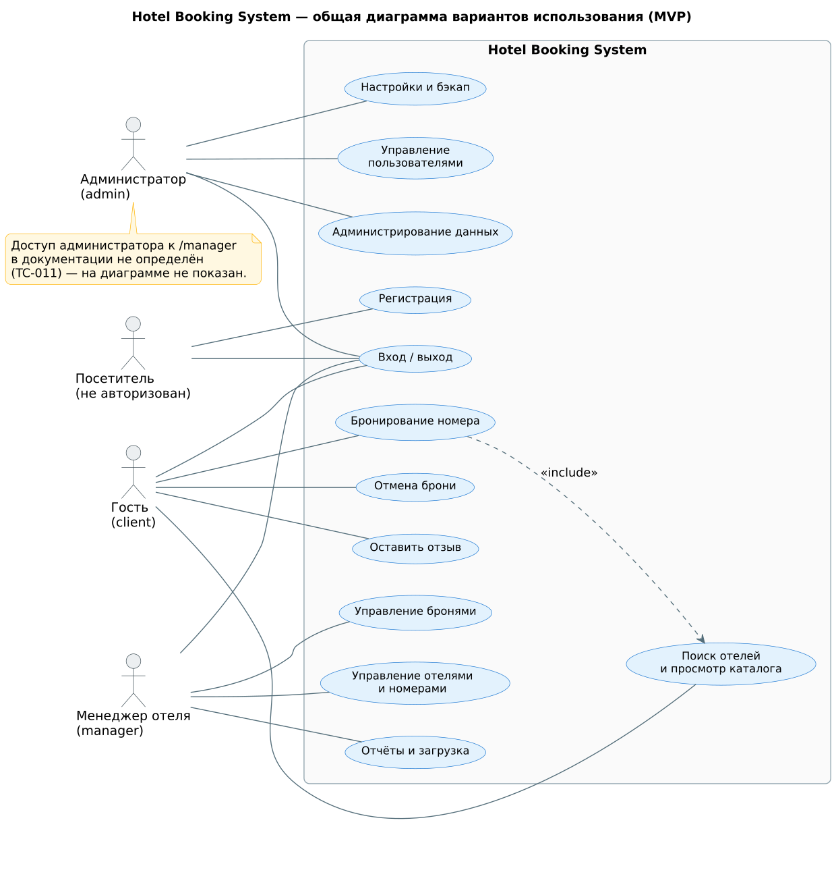

# 🏨 Hotel Booking System — документация

Документация проекта бронирования отелей: бизнес-требования, риски, архитектура, пользовательские сценарии, модель данных, стратегия тестирования, дорожная карта и UML-диаграммы вариантов использования.

Проект — Python/Flask-приложение с API Gateway и пятью сервисами (`auth`, `booking`, `catalog`, `manager`, `admin`) поверх общей PostgreSQL-базы. Документы описывают текущее состояние (MVP) и целевые улучшения.

## 📂 Структура репозитория

```text
.
├── README.md
├── docs/
│   ├── README.md                      # оглавление документации
│   ├── 01-business-requirements.md    # цели, персоны, User Stories, FR/NFR, критерии приёмки
│   ├── 02-architecture.md             # слои, стек, sequence-диаграммы, API
│   ├── 03-risks.md                    # реестр рисков, OWASP, PCI DSS, персональные данные
│   ├── 04-user-flows.md               # сценарии и wireframe
│   ├── 05-data-model.md               # ER-диаграмма, сущности, индексы
│   ├── 06-testing-strategy.md         # пирамида тестов, тест-кейсы
│   ├── 07-roadmap.md                  # MVP → Phase 2 → Phase 3
│   ├── 08-use-cases.md                # UML Use Case диаграммы
│   └── diagrams/
│       ├── src/                       # PlantUML-исходники (.puml)
│       └── img/                       # готовые SVG и PNG
└── scripts/
    └── render-diagrams.sh             # перерисовка диаграмм
```

## 🚀 С чего начать

| Задача | Документ |
|--------|----------|
| Понять цели и границы MVP | [Бизнес-требования](./docs/01-business-requirements.md) |
| Оценить, что может пойти не так | [Риски](./docs/03-risks.md) |
| Увидеть роли и сценарии на схемах | [Диаграммы вариантов использования](./docs/08-use-cases.md) |
| Разобраться в устройстве системы | [Архитектура](./docs/02-architecture.md) |
| Спланировать развитие | [Дорожная карта](./docs/07-roadmap.md) |

Полное оглавление — в [docs/README.md](./docs/README.md).

## 🎭 UML-диаграммы использования

| Диаграмма | Что показывает |
|-----------|----------------|
| [Общая схема (MVP)](./docs/diagrams/img/01-system-overview.svg) | Все роли и укрупнённые группы функций |
| [Гость](./docs/diagrams/img/02-guest.svg) | Регистрация, поиск, бронирование, отмена, отзывы |
| [Менеджер](./docs/diagrams/img/03-manager.svg) | Брони, отели, номера, отчёты, загрузка |
| [Администратор](./docs/diagrams/img/04-admin.svg) | Пользователи, данные системы, настройки, бэкап |
| [Phase 2](./docs/diagrams/img/05-phase2.svg) | Оплата, уведомления, REST API |



## 🛠️ Перерисовка диаграмм

Нужны Java, Graphviz и [`plantuml.jar`](https://github.com/plantuml/plantuml/releases):

```bash
PLANTUML_JAR=/path/to/plantuml.jar ./scripts/render-diagrams.sh
```

Mermaid-диаграммы в остальных документах GitHub отображает автоматически.
