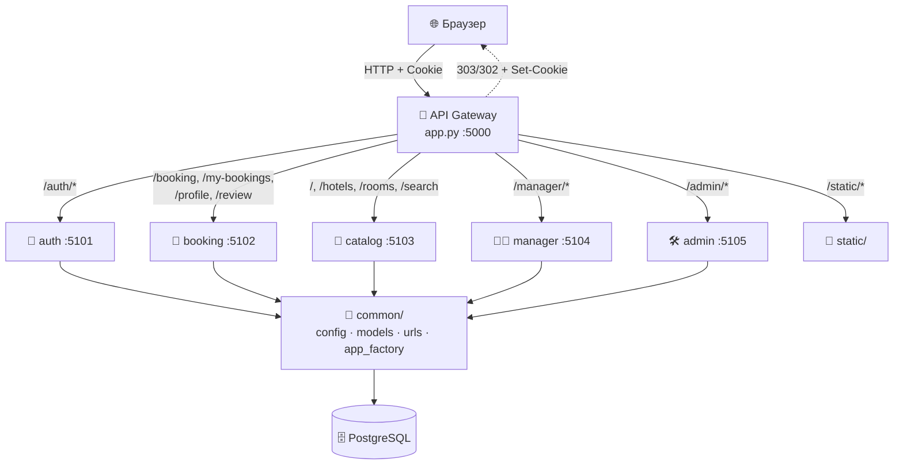
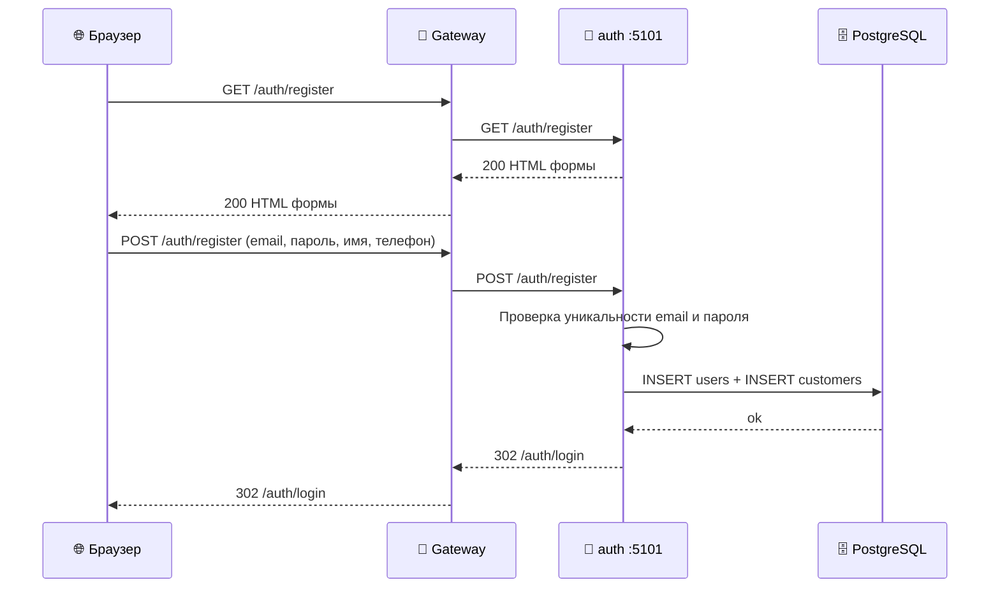
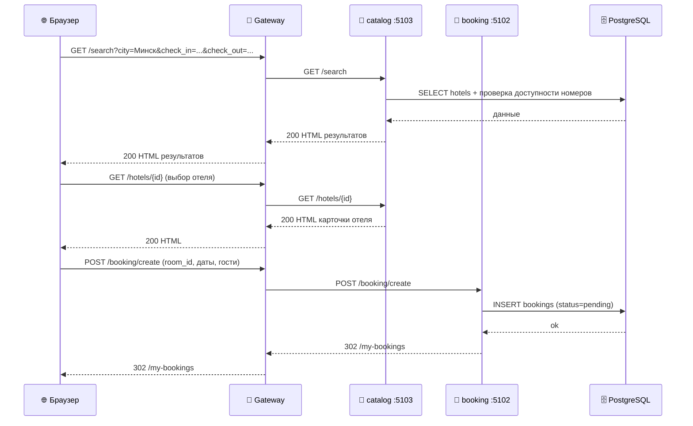
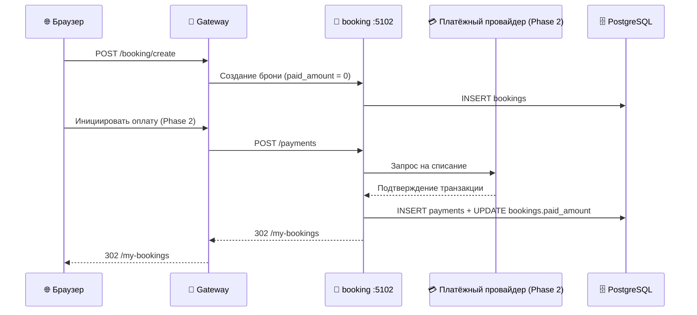
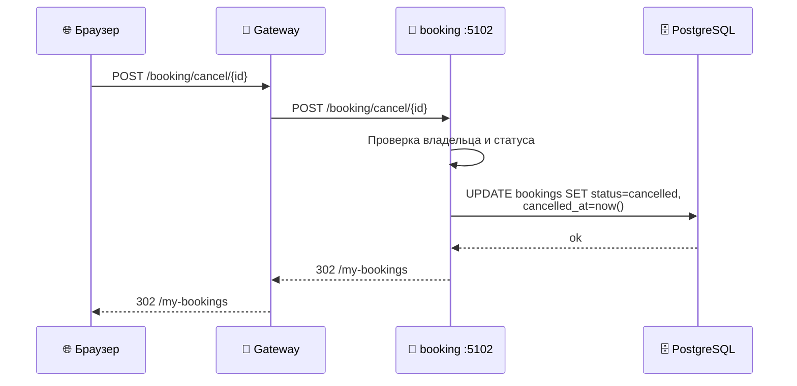
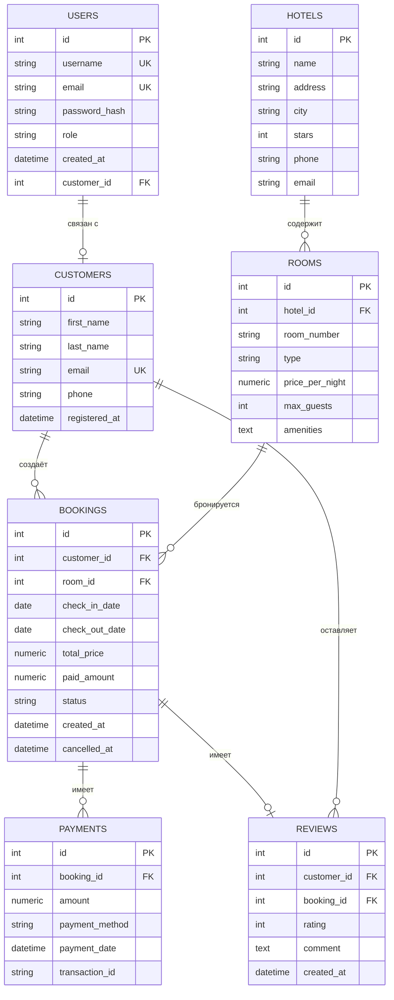

# 🏗️ Архитектура системы

## 📌 TL;DR

Система построена по клиент-серверной модели с серверным рендерингом HTML и микросервисным бэкендом. Браузер обращается к API Gateway (порт 5000), который направляет запрос одному из пяти сервисов и возвращает готовую страницу. Все сервисы используют одну PostgreSQL-базу и общие шаблоны. Публичного JSON API в текущей версии нет — он описан как целевое состояние Phase 2.

---

## 🧩 Обзор архитектуры

### Слои

| Слой | Что входит | Ответственность |
|------|------------|-----------------|
| Представление | Jinja2-шаблоны, Bootstrap 5.3, Font Awesome, `static/style.css` | Отображение данных, формы, навигация |
| Gateway | `app.py` | Маршрутизация, проксирование, статика, управление процессами |
| Сервисы | `services/auth`, `booking`, `catalog`, `manager`, `admin` | Бизнес-логика своего домена |
| Shared kernel | `common/` | Конфигурация, модели, фабрика приложений, карта URL |
| Данные | PostgreSQL, `common/models.py` | Хранение пользователей, отелей, номеров, броней, платежей, отзывов |

### Стек технологий

| Компонент | Технология |
|-----------|------------|
| Язык | Python 3 |
| Веб-фреймворк | Flask (в `requirements.txt`: 2.3.3) |
| ORM | Flask-SQLAlchemy / SQLAlchemy |
| БД | PostgreSQL (`DATABASE_URL` в `.env`) |
| Аутентификация | Flask-Login, Werkzeug password hash |
| Шаблоны | Jinja2 |
| Фронтенд | HTML, Bootstrap 5.3 (CDN), Font Awesome 6.4 (CDN), CSS |
| Конфигурация | python-dotenv |
| Архитектура | API Gateway + 5 микросервисов, отдельные процессы |

> ⚠️ `package.json` в проекте отсутствует: это Python-проект, а не Node.js.

---

## 🧱 Компонентная диаграмма



---

## 🔄 Sequence-диаграммы ключевых сценариев

### Регистрация пользователя



### Поиск и бронирование номера



### Оплата

> Текущая реализация: реального платёжного шлюза нет, система только хранит записи `Payment`. Ниже — целевой сценарий для Phase 2 с абстрактным провайдером.



### Отмена брони



---

## 🗄️ ER-диаграмма базы данных



Подробности полей, типов и ограничений — в [модели данных](./05-data-model.md).

---

## 🔌 Описание API

### Текущее состояние: HTML-роуты

Публичного JSON API нет (кроме `/_ping`). Все ответы — HTML-страницы или редиректы. Коды: `200` — страница, `302` — редирект после POST, `404` — не найдено, `500` — внутренняя ошибка.

| Метод | Путь | Сервис | Назначение | Коды ответа |
|-------|------|--------|------------|-------------|
| GET | `/` | catalog | Главная | 200, 500 |
| GET | `/hotels` | catalog | Каталог отелей | 200, 500 |
| GET | `/hotels/<int:hotel_id>` | catalog | Карточка отеля | 200, 404, 500 |
| GET | `/rooms` | catalog | Каталог номеров | 200, 500 |
| GET | `/search` | catalog | Поиск отелей | 200, 302, 500 |
| GET | `/my-bookings` | booking | Мои бронирования | 200, 302, 500 |
| POST | `/booking/create` | booking | Создание брони | 302, 500 |
| POST | `/booking/cancel/<int:booking_id>` | booking | Отмена брони | 302, 404, 500 |
| GET, POST | `/profile` | booking | Профиль (шаблон отсутствует) | 200, 302, 500 |
| GET, POST | `/review/create/<int:booking_id>` | booking | Отзыв | 200, 302, 404, 500 |
| GET, POST | `/auth/login` | auth | Вход | 200, 302, 500 |
| GET, POST | `/auth/register` | auth | Регистрация | 200, 302, 500 |
| GET | `/auth/logout` | auth | Выход | 302, 500 |
| GET | `/manager` | manager | Дашборд менеджера | 200, 302, 500 |
| GET | `/manager/bookings` | manager | Брони | 200, 302, 500 |
| POST | `/manager/booking/<int:booking_id>/status` | manager | Смена статуса | 302, 404, 500 |
| POST | `/manager/booking/<int:booking_id>/delete` | manager | Удаление брони | 302, 404, 500 |
| GET | `/manager/hotels` | manager | Отели | 200, 302, 500 |
| GET, POST | `/manager/hotel/add` | manager | Добавление отеля | 200, 302, 500 |
| GET, POST | `/manager/hotel/<int:hotel_id>/edit` | manager | Редактирование отеля | 200, 302, 404, 500 |
| POST | `/manager/hotel/<int:hotel_id>/delete` | manager | Удаление отеля | 302, 404, 500 |
| GET | `/manager/rooms` | manager | Номера | 200, 302, 500 |
| GET, POST | `/manager/room/add` | manager | Добавление номера | 200, 302, 500 |
| GET, POST | `/manager/room/<int:room_id>/edit` | manager | Редактирование номера | 200, 302, 404, 500 |
| POST | `/manager/room/<int:room_id>/delete` | manager | Удаление номера | 302, 404, 500 |
| GET | `/manager/customers` | manager | Клиенты | 200, 302, 500 |
| GET | `/manager/payments` | manager | Платежи | 200, 302, 500 |
| GET | `/manager/reports` | manager | Отчёты | 200, 302, 500 |
| GET | `/manager/occupancy` | manager | Загрузка | 200, 302, 500 |
| GET | `/manager/occupancy/hotel/<int:hotel_id>` | manager | Загрузка отеля | 200, 302, 404, 500 |
| GET, POST | `/manager/profile` | manager | Профиль менеджера | 200, 302, 500 |
| GET | `/admin` | admin | Дашборд администратора | 200, 302, 500 |
| GET | `/admin/users` | admin | Пользователи | 200, 302, 500 |
| GET, POST | `/admin/user/create` | admin | Создание пользователя | 200, 302, 500 |
| GET, POST | `/admin/user/<int:user_id>/edit` | admin | Редактирование пользователя | 200, 302, 404, 500 |
| POST | `/admin/user/<int:user_id>/delete` | admin | Удаление пользователя | 302, 404, 500 |
| GET | `/admin/customers` | admin | Клиенты | 200, 302, 500 |
| GET, POST | `/admin/customer/<int:customer_id>/edit` | admin | Редактирование клиента | 200, 302, 404, 500 |
| POST | `/admin/customer/<int:customer_id>/delete` | admin | Удаление клиента | 302, 404, 500 |
| GET | `/admin/bookings` | admin | Брони | 200, 302, 500 |
| POST | `/admin/booking/<int:booking_id>/delete` | admin | Удаление брони | 302, 404, 500 |
| GET | `/admin/payments` | admin | Платежи | 200, 302, 500 |
| POST | `/admin/payment/<int:payment_id>/delete` | admin | Удаление платежа | 302, 404, 500 |
| GET | `/admin/reviews` | admin | Отзывы | 200, 302, 500 |
| POST | `/admin/review/<int:review_id>/delete` | admin | Удаление отзыва | 302, 404, 500 |
| GET | `/admin/hotels` | admin | Отели | 200, 302, 500 |
| GET | `/admin/reports` | admin | Отчёты | 200, 302, 500 |
| GET | `/admin/settings` | admin | Настройки | 200, 302, 500 |
| GET | `/admin/system-info` | admin | Информация о системе | 200, 302, 500 |
| GET | `/admin/backup` | admin | Бэкап | 200, 302, 500 |
| POST | `/admin/backup/create` | admin | Создать бэкап | 302, 500 |
| GET | `/_ping` | любой | Health-check | 200 |
| GET | `/static/<path:filename>` | gateway | Статика | 200, 404 |

### Целевое REST API (Phase 2)

| Метод | Путь | Назначение | Успех | Ошибки |
|-------|------|------------|-------|--------|
| POST | `/api/v1/auth/register` | Регистрация | 201 | 400, 409, 422 |
| POST | `/api/v1/auth/login` | Вход | 200 | 401, 422 |
| POST | `/api/v1/auth/logout` | Выход | 204 | 401 |
| GET | `/api/v1/hotels` | Список отелей | 200 | 500 |
| GET | `/api/v1/hotels/{id}` | Отель | 200 | 404 |
| GET | `/api/v1/hotels/{id}/rooms/available` | Свободные номера | 200 | 400, 404 |
| POST | `/api/v1/bookings` | Создание брони | 201 | 400, 401, 409, 422 |
| GET | `/api/v1/me/bookings` | Мои брони | 200 | 401 |
| POST | `/api/v1/bookings/{id}/cancel` | Отмена | 204 | 401, 403, 404, 409 |
| POST | `/api/v1/bookings/{id}/reviews` | Отзыв | 201 | 400, 401, 404, 409 |
| POST | `/api/v1/payments` | Инициация оплаты | 201 | 400, 401, 402, 422 |
| GET | `/api/v1/manager/bookings` | Брони менеджера | 200 | 401, 403 |
| GET | `/api/v1/admin/users` | Пользователи | 200 | 401, 403 |

**Единый формат ошибки (целевой):**

```json
{
  "error": {
    "code": "VALIDATION_ERROR",
    "message": "Некорректные данные формы",
    "details": {"email": "Обязательное поле"}
  }
}
```
