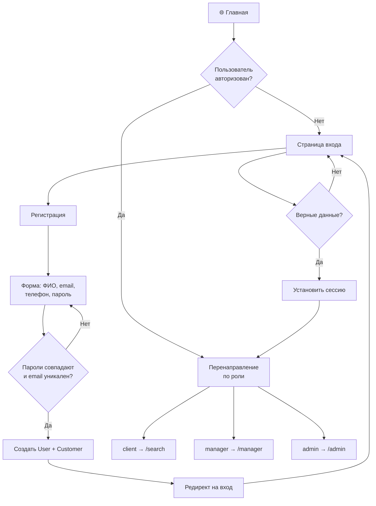
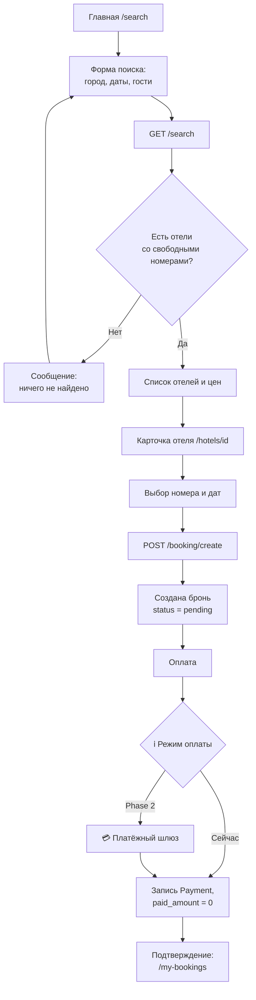

# 🧭 Пользовательские сценарии

## 📌 TL;DR

Основной путь гостя: зарегистрироваться → войти → найти отель → выбрать номер → забронировать → посмотреть бронь. Менеджер работает с бронями, отелями и отчётами, администратор — с пользователями и целостностью данных. Ниже — Mermaid-схемы сценариев и текстовые wireframe ключевых экранов.

---

## 🔐 Регистрация и авторизация



---

## 🏨 Поиск → выбор → бронирование → оплата → подтверждение



---

## 📅 Управление бронями

```mermaid
flowchart TD
    A[/my-bookings] --> B[Список броней пользователя]
    B --> C{Действие}
    C -- Отменить --> D[POST /booking/cancel/id]
    D --> E[status = cancelled,<br/>cancelled_at]
    E --> B

    C -- Оставить отзыв --> F[/review/create/id]
    F --> G[Форма: оценка, комментарий]
    G --> H[INSERT reviews]
    H --> B

    C -- Просмотр отеля --> I[/hotels/id]

    J[Менеджер: /manager/bookings] --> K[Смена статуса]
    K --> L[pending → confirmed → paid → completed]
    J --> M[Удаление брони]
```

---

## 👤 Личный кабинет

```mermaid
flowchart TD
    A[Авторизованный пользователь] --> B{Роль}
    B -- client --> C[/my-bookings]
    C --> C1[Мои брони]
    C --> C2[Отзывы]
    C --> C3[/profile<br/>⚠️ шаблон отсутствует]

    B -- manager --> D[/manager]
    D --> D1[Брони и статусы]
    D --> D2[Отели и номера]
    D --> D3[Клиенты и платежи]
    D --> D4[Отчёты и загрузка]
    D --> D5[/manager/profile]

    B -- admin --> E[/admin]
    E --> E1[Пользователи]
    E --> E2[Клиенты, брони, платежи]
    E --> E3[Отзывы и настройки]
    E --> E4[Системная информация и бэкап]
```

---

## 🖼️ Wireframe ключевых экранов

### 🏠 Главная (`/`)

```
┌──────────────────────────────────────────────┐
│ HotelBooking.BY   Главная  Отели  Войти     │
├──────────────────────────────────────────────┤
│              Поиск отеля                    │
│  [Город]  [Заезд]  [Выезд]  [Гости] [Найти] │
├──────────────────────────────────────────────┤
│  Популярные отели                           │
│  ┌────────┐ ┌────────┐ ┌────────┐           │
│  │ Отель  │ │ Отель  │ │ Отель  │           │
│  │ ★★★★★ │ │ ★★★★☆ │ │ ★★★☆☆ │           │
│  └────────┘ └────────┘ └────────┘           │
├──────────────────────────────────────────────┤
│ Футер: Hotel Booking System © 2026          │
└──────────────────────────────────────────────┘
```

### 🔎 Результаты поиска (`/search`)

```
┌──────────────────────────────────────────────┐
│ Форма поиска (город, даты, гости)            │
├──────────────────────────────────────────────┤
│ Найдено: 3 отеля                            │
│ ┌──────────────────────────────────────────┐ │
│ │ 🏨 Отель Европа · Минск · ★★★★★        │ │
│ │ Свободно номеров: 4 · от 120 BYN/ночь   │ │
│ │ [Выбрать]                               │ │
│ └──────────────────────────────────────────┘ │
└──────────────────────────────────────────────┘
```

### 🏨 Карточка отеля (`/hotels/<id>`)

```
┌──────────────────────────────────────────────┐
│ Название, адрес, город, звёздность           │
│ Телефон, email                               │
├──────────────────────────────────────────────┤
│ Свободные номера на даты:                    │
│ • Люкс — 2 гостя — 180 BYN/ночь [Забронировать]│
│ • Стандарт — 2 гостя — 120 BYN/ночь [..]    │
├──────────────────────────────────────────────┤
│ Отзывы гостей: ★★★★☆ «Отличный отель»       │
└──────────────────────────────────────────────┘
```

### 📝 Форма бронирования (`POST /booking/create`)

```
┌──────────────────────────────────────────────┐
│ Бронирование номера                          │
│ Номер: Люкс                                  │
│ Заезд: [YYYY-MM-DD] Выезд: [YYYY-MM-DD]      │
│ Гости: [1-4]                                 │
│ Итого: 360 BYN                               │
│               [Подтвердить бронь]            │
└──────────────────────────────────────────────┘
```

### 📅 Мои бронирования (`/my-bookings`)

```
┌──────────────────────────────────────────────┐
│ Мои бронирования                             │
│ ┌──────────────────────────────────────────┐ │
│ │ Бронь #12 · Отель Европа · Люкс          │ │
│ │ 2026-12-01 → 2026-12-04 · 360 BYN        │ │
│ │ Статус: pending                          │ │
│ │ [Отменить] [Оставить отзыв]              │ │
│ └──────────────────────────────────────────┘ │
└──────────────────────────────────────────────┘
```

### 🔑 Вход и регистрация (`/auth/login`, `/auth/register`)

```
┌──────────────────────────────────────────────┐
│ Вход                     Регистрация         │
│ Email: [__________]      Фамилия: [______]   │
│ Пароль: [________]       Имя: [__________]   │
│ [Войти]                  Email: [________]   │
│                          Телефон: [______]   │
│                          Пароль: [________]  │
│                          Подтверждение: [...]│
│                          [Зарегистрироваться]│
└──────────────────────────────────────────────┘
```

### 🧑‍💼 Панель менеджера (`/manager`)

```
┌──────────────────────────────────────────────┐
│ Меню: Панель | Загрузка | Бронирования |    │
│       Отели | Номера | Клиенты | Платежи |   │
│       Отчёты | Профиль                       │
├──────────────────────────────────────────────┤
│ Сводка: отели / номера / брони / выручка     │
│ Таблица броней с фильтрами и действиями      │
└──────────────────────────────────────────────┘
```

### 🛠️ Административная панель (`/admin`)

```
┌──────────────────────────────────────────────┐
│ Меню: Пользователи | Клиенты | Брони |      │
│ Платежи | Отзывы | Отели | Отчёты |         │
│ Настройки | Система | Бэкап                  │
├──────────────────────────────────────────────┤
│ Статистика: users / hotels / rooms / bookings│
│ Таблица данных с формами редактирования      │
└──────────────────────────────────────────────┘
```
