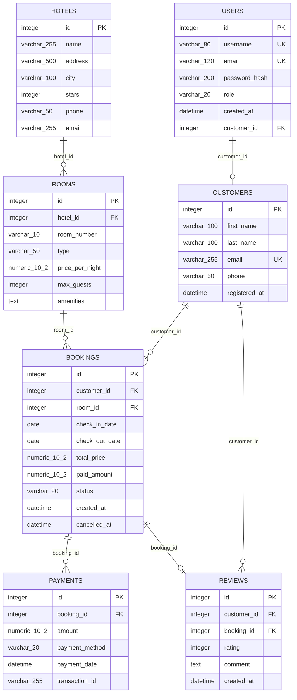

# 🗄️ Модель данных

## 📌 TL;DR

База данных реляционная (PostgreSQL), состоит из 7 таблиц: `users`, `customers`, `hotels`, `rooms`, `bookings`, `payments`, `reviews`. Связи строятся через внешние ключи. Явные индексы в коде не определены — создаются только первичные и уникальные ключи; рекомендуемые индексы перечислены ниже. Миграции отсутствуют, `triggers.sql` не применяется автоматически.

---

## 🧬 Полная ER-диаграмма

---

## 📑 Описание сущностей

### 👤 `users` — пользователи системы

| Поле | Тип | NULL | По умолчанию | Ограничения |
|------|-----|------|--------------|-------------|
| `id` | Integer | нет | автоинкремент | PRIMARY KEY |
| `username` | VARCHAR(80) | нет | — | UNIQUE |
| `email` | VARCHAR(120) | нет | — | UNIQUE |
| `password_hash` | VARCHAR(200) | нет | — | Хеш Werkzeug |
| `role` | VARCHAR(20) | да | `client` | `client` / `manager` / `admin` |
| `created_at` | DateTime | да | `datetime.utcnow()` | — |
| `customer_id` | Integer | да | — | FK → `customers.id` |

### 🧾 `customers` — профили гостей

| Поле | Тип | NULL | По умолчанию | Ограничения |
|------|-----|------|--------------|-------------|
| `id` | Integer | нет | автоинкремент | PRIMARY KEY |
| `first_name` | VARCHAR(100) | нет | — | — |
| `last_name` | VARCHAR(100) | нет | — | — |
| `email` | VARCHAR(255) | нет | — | UNIQUE |
| `phone` | VARCHAR(50) | нет | — | — |
| `registered_at` | DateTime | да | `datetime.utcnow()` | — |

### 🏨 `hotels` — отели

| Поле | Тип | NULL | По умолчанию | Ограничения |
|------|-----|------|--------------|-------------|
| `id` | Integer | нет | автоинкремент | PRIMARY KEY |
| `name` | VARCHAR(255) | нет | — | — |
| `address` | VARCHAR(500) | да | — | — |
| `city` | VARCHAR(100) | нет | — | — |
| `stars` | Integer | да | — | 1–5 по смыслу |
| `phone` | VARCHAR(50) | да | — | — |
| `email` | VARCHAR(255) | да | — | — |

### 🚪 `rooms` — номера

| Поле | Тип | NULL | По умолчанию | Ограничения |
|------|-----|------|--------------|-------------|
| `id` | Integer | нет | автоинкремент | PRIMARY KEY |
| `hotel_id` | Integer | нет | — | FK → `hotels.id` |
| `room_number` | VARCHAR(10) | нет | — | — |
| `type` | VARCHAR(50) | нет | — | `economy`, `standard`, `superior`, `luxury`, `presidential` |
| `price_per_night` | NUMERIC(10,2) | нет | — | ≥ 0 по смыслу |
| `max_guests` | Integer | нет | — | ≥ 1 по смыслу |
| `amenities` | Text | да | — | — |

### 📅 `bookings` — бронирования

| Поле | Тип | NULL | По умолчанию | Ограничения |
|------|-----|------|--------------|-------------|
| `id` | Integer | нет | автоинкремент | PRIMARY KEY |
| `customer_id` | Integer | нет | — | FK → `customers.id` |
| `room_id` | Integer | нет | — | FK → `rooms.id` |
| `check_in_date` | Date | нет | — | — |
| `check_out_date` | Date | нет | — | должно быть > `check_in_date` |
| `total_price` | NUMERIC(10,2) | нет | — | — |
| `paid_amount` | NUMERIC(10,2) | да | `0` | — |
| `status` | VARCHAR(20) | да | `pending` | `pending`, `confirmed`, `paid`, `completed`, `cancelled`, `no_show` |
| `created_at` | DateTime | да | `datetime.utcnow()` | — |
| `cancelled_at` | DateTime | да | — | заполняется при отмене |

### 💳 `payments` — платежи

| Поле | Тип | NULL | По умолчанию | Ограничения |
|------|-----|------|--------------|-------------|
| `id` | Integer | нет | автоинкремент | PRIMARY KEY |
| `booking_id` | Integer | нет | — | FK → `bookings.id` |
| `amount` | NUMERIC(10,2) | нет | — | — |
| `payment_method` | VARCHAR(20) | нет | — | `card`, `cash` в тестовых данных |
| `payment_date` | DateTime | да | `datetime.utcnow()` | — |
| `transaction_id` | VARCHAR(255) | да | — | в сидах генерируется как `txn_...` |

### ⭐ `reviews` — отзывы

| Поле | Тип | NULL | По умолчанию | Ограничения |
|------|-----|------|--------------|-------------|
| `id` | Integer | нет | автоинкремент | PRIMARY KEY |
| `customer_id` | Integer | нет | — | FK → `customers.id` |
| `booking_id` | Integer | нет | — | FK → `bookings.id` |
| `rating` | Integer | нет | — | 1–5 по смыслу |
| `comment` | Text | да | — | — |
| `created_at` | DateTime | да | `datetime.utcnow()` | — |

---

## 🔗 Связи между таблицами

| Родитель | Ребёнок | Тип | Внешний ключ | Комментарий |
|----------|---------|-----|--------------|-------------|
| `customers` | `users` | 1:0..1 | `users.customer_id` | Пользователь может быть связан с клиентом |
| `customers` | `bookings` | 1:N | `bookings.customer_id` | История броней гостя |
| `hotels` | `rooms` | 1:N | `rooms.hotel_id` | Номера отеля |
| `rooms` | `bookings` | 1:N | `bookings.room_id` | Бронь конкретного номера |
| `bookings` | `payments` | 1:N | `payments.booking_id` | История платежей по брони |
| `bookings` | `reviews` | 1:0..1 | `reviews.booking_id` | Один отзыв на бронь |
| `customers` | `reviews` | 1:N | `reviews.customer_id` | Отзывы гостя |

---

## 🧷 Индексы

**Фактически создаются автоматически:**

- PRIMARY KEY для всех таблиц;
- UNIQUE для `users.username`, `users.email`, `customers.email`.

**Рекомендуется добавить (сейчас отсутствуют):**

| Таблица | Поля | Причина |
|---------|------|---------|
| `rooms` | `hotel_id` | Выборка номеров отеля |
| `bookings` | `customer_id` | «Мои бронирования» |
| `bookings` | `room_id`, `check_in_date`, `check_out_date`, `status` | Проверка доступности и отчёты |
| `payments` | `booking_id`, `payment_date` | Отчёты по выручке |
| `reviews` | `booking_id`, `customer_id` | Выборка отзывов отеля |

---

## 🧩 Особенности и ограничения

- Схема создаётся через `db.create_all()` при запуске; миграции не ведутся.
- `triggers.sql` лежит в репозитории, но не применяется и в коде не используется.
- Нет ограничения уникальности на комбинацию `room_id + даты + status`; пересечение броней предотвращается только логикой `get_available_rooms()` на уровне приложения.
- Каскадное удаление не настроено: удаление отеля/клиента может оставить «висячие» записи.
- Связь `users ↔ customers` неявная: при регистрации создаются обе записи, но целостность транзакции не гарантирована полностью.
