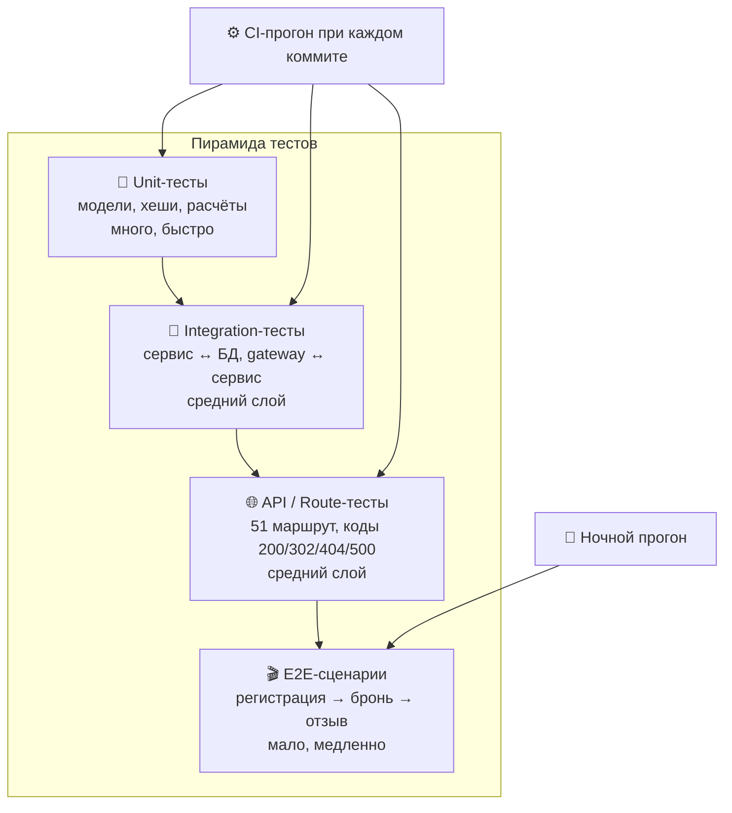

# 🧪 Стратегия тестирования

## 📌 TL;DR

Автоматизированных тестов в репозитории сейчас нет — проверки проводились вручную (compile, smoke, role-тест, 51 маршрут). Стратегия описывает пирамиду тестов от unit до e2e, матрицу тест-кейсов, негативные сценарии и критерии готовности релиза. Числовых SLA-целей не задано, поэтому performance-цели сформулированы качественно. Известные дефекты (`/profile`, `seed_big_data.py`, `to_char` в `/manager/occupancy`) зафиксированы отдельно.

---

## 🎯 Цели тестирования

| ID | Цель | Что проверяем |
|----|------|---------------|
| TG-001 | Сохранение поведения | Разделение на сервисы не изменило маршруты, данные и интерфейс |
| TG-002 | Корректность бизнес-логики | Доступность номеров, расчёт стоимости, статусы брони |
| TG-003 | Безопасность доступа | Роли `client` / `manager` / `admin`, закрытые разделы |
| TG-004 | Целостность данных | Связи между таблицами, каскадные случаи, уникальность |
| TG-005 | Стабильность запуска | Gateway поднимает и останавливает все 5 сервисов |
| TG-006 | Регрессия | Известные дефекты не усугубляются и не появляются новые |

---

## 🔺 Пирамида тестов

---

## 🧰 Инструменты и окружение

| Компонент | Рекомендация | Статус |
|-----------|--------------|--------|
| Юнит/интеграционные тесты | `pytest` + `pytest-cov` | Требуется внедрить |
| Тестовая БД | SQLite in-memory для unit; PostgreSQL для интеграции | Частично используется |
| HTTP-клиент | `pytest-flask` / Flask `test_client` | Требуется внедрить |
| E2E | Playwright или Selenium | Планируется |
| Статический анализ | `ruff` / `flake8`, `mypy` | Планируется |
| Сканирование зависимостей | `pip-audit` / Dependabot | Планируется |
| CI | GitHub Actions / локальный pre-commit | Планируется |
| Текущие проверки | `python -m compileall`, smoke-скрипты, role-тест | Выполнялись вручную |

> ⚠️ `/manager/occupancy` использует PostgreSQL-функцию `to_char`, поэтому на SQLite-тестовой БД падает. Для интеграционных тестов этого раздела нужна реальная PostgreSQL.

---

## 📋 Матрица тест-кейсов

### 🔐 Авторизация и роли

| ID | Сценарий | Шаги | Ожидаемый результат |
|----|----------|------|---------------------|
| TC-001 | Регистрация | POST `/auth/register` с валидными данными | Созданы `User` и `Customer`, редирект `/auth/login` |
| TC-002 | Дубли email | POST `/auth/register` с существующим email | Сообщение об ошибке, без «осиротевшего» пользователя |
| TC-003 | Короткий пароль | Пароль из 4 символов | В текущей версии принимается — зафиксировать как RISK-005 |
| TC-004 | Несовпадение паролей | Разные `password` и `confirm` | Форма возвращается с ошибкой |
| TC-005 | Вход | POST `/auth/login` верные данные | Сессия установлена, редирект по роли |
| TC-006 | Неверный логин | POST с неверным паролем | Ошибка, сессия не создана |
| TC-007 | Выход | GET `/auth/logout` | Сессия сброшена, редирект на вход |
| TC-008 | Гость в `/manager` | GET `/manager` без роли | 302 на `/auth/login` |
| TC-009 | Гость в `/admin` | GET `/admin` без роли | 302 на `/auth/login` |
| TC-010 | Менеджер в `/admin` | GET `/admin` ролью `manager` | 302 / 403 |
| TC-011 | Админ в `/manager` | GET `/manager` ролью `admin` | Доступ в соответствии с матрицей прав |

### 🏨 Каталог и поиск

| ID | Сценарий | Шаги | Ожидаемый результат |
|----|----------|------|---------------------|
| TC-012 | Главная | GET `/` | 200, список популярных отелей |
| TC-013 | Каталог отелей | GET `/hotels` | 200, все отели |
| TC-014 | Карточка отеля | GET `/hotels/<id>` | 200, номера и отзывы |
| TC-015 | Несуществующий отель | GET `/hotels/999999` | 404 |
| TC-016 | Поиск по городу | GET `/search?city=Минск` | Только отели из Минска |
| TC-017 | Поиск по датам | Даты с пересечением брони | Номер исключён из доступных |
| TC-018 | Свободные номера | Даты без брони | Номер отображается с ценой |
| TC-019 | Пустой результат | Город без отелей | Сообщение «ничего не найдено» |
| TC-020 | Каталог номеров | GET `/rooms` | 200, список номеров |

### 📅 Бронирование и отзывы

| ID | Сценарий | Шаги | Ожидаемый результат |
|----|----------|------|---------------------|
| TC-021 | Создание брони | POST `/booking/create` | `status=pending`, `total_price` рассчитана |
| TC-022 | Мои брони | GET `/my-bookings` | Только брони текущего пользователя |
| TC-023 | Отмена своей брони | POST `/booking/cancel/<id>` | `status=cancelled`, `cancelled_at` заполнено |
| TC-024 | Отмена чужой брони | POST от другого пользователя | Отказ / 404 |
| TC-025 | Повторная отмена | POST cancel для `cancelled` | Ошибка конфликта состояния |
| TC-026 | Отзыв | POST `/review/create/<id>` | Отзыв создан, виден на странице отеля |
| TC-027 | Отзыв без брони | POST с несуществующим `booking_id` | 404 / ошибка валидации |
| TC-028 | Две брони на один номер | Пересекающиеся даты | Вторая бронь не создаётся |

### 🧑‍💼 Менеджер и 🛠️ администратор

| ID | Сценарий | Шаги | Ожидаемый результат |
|----|----------|------|---------------------|
| TC-029 | Дашборд менеджера | GET `/manager` | 200, сводка |
| TC-030 | Смена статуса | POST `/manager/booking/<id>/status` | Статус обновлён в списке |
| TC-031 | CRUD отеля | add → edit → delete | Изменения отражены в каталоге |
| TC-032 | CRUD номера | add → edit → delete | Изменения отражены в отеле |
| TC-033 | Отчёт по загрузке | GET `/manager/occupancy` | 200 на PostgreSQL |
| TC-034 | Отчёт на SQLite | GET `/manager/occupancy` | Падение из-за `to_char` — ожидаемый дефект |
| TC-035 | Создание пользователя | POST `/admin/user/create` | Новый пользователь может войти |
| TC-036 | Удаление пользователя | POST `/admin/user/<id>/delete` | Запись удалена, доступ закрыт |
| TC-037 | Админ-таблицы | GET `/admin/customers`, `/payments`, `/reviews` | 200, данные отображаются |
| TC-038 | Бэкап | POST `/admin/backup/create` | Файл создан, редирект |

### 🚪 Gateway и инфраструктура

| ID | Сценарий | Шаги | Ожидаемый результат |
|----|----------|------|---------------------|
| TC-039 | Health-check | GET `/_ping` | 200 от gateway и каждого сервиса |
| TC-040 | Запуск | `python app.py` | Gateway :5000 и сервисы :5101–5105 подняты |
| TC-041 | Остановка | Ctrl+C | Все дочерние процессы завершены |
| TC-042 | Проксирование | GET `/auth/login` через :5000 | HTML от сервиса :5101 без изменения URL |
| TC-043 | Статика | GET `/static/style.css` | 200 |
| TC-044 | 51 маршрут | Сравнение `common/urls.py` и `url_map` | Все маршруты доступны через gateway |
| TC-045 | Недоступный сервис | Остановить :5102, GET `/my-bookings` | Ошибка gateway, остальные разделы работают |

---

## 🔴 Негативные сценарии

| ID | Сценарий | Проверка |
|----|----------|----------|
| NEG-001 | Пересечение дат брони | Нельзя забронировать занятый номер |
| NEG-002 | `check_out <= check_in` | Ошибка валидации |
| NEG-003 | Отрицательная цена | Отклонение |
| NEG-004 | Некорректный `rating` (0 или 6) | Отклонение |
| NEG-005 | Пустые обязательные поля | Сообщения валидации |
| NEG-006 | SQL-подобный ввод в поиск | Параметризация, без выполнения SQL |
| NEG-007 | XSS в отзыве | Экранирование Jinja2 |
| NEG-008 | Подмена ID в URL | 404 / отказ доступа к чужим данным |
| NEG-009 | Просроченная сессия | Редирект на вход |
| NEG-010 | Недоступность БД | Понятная ошибка вместо стектрейса |

---

## 🐛 Известные дефекты (регрессионный контроль)

| ID | Дефект | Текущее поведение | Ожидаемое после исправления |
|----|--------|-------------------|-----------------------------|
| BUG-001 | `GET /profile` | 500 — отсутствует `profile.html` | 200 с формой профиля |
| BUG-002 | `seed_big_data.py` | SyntaxError при запуске | Скрипт выполняется и наполняет БД |
| BUG-003 | `/manager/occupancy` | Падает на SQLite из-за `to_char` | Работает и на SQLite, и на PostgreSQL |
| BUG-004 | Дубль `customers.email` | 500 и «осиротевший» `User` | Атомарная транзакция и валидация |

> Связано с рисками [RISK-008, RISK-009, RISK-011](./03-risks.md).

---

## ✅ Критерии готовности релиза

| ID | Критерий | Проверка |
|----|----------|----------|
| QA-001 | Все 51 маршрут доступны через gateway | TC-044 |
| QA-002 | Ролевые тесты пройдены | TC-008…TC-011 |
| QA-003 | Критичные дефекты BUG-001…BUG-004 закрыты | Регрессионный прогон |
| QA-004 | Unit-покрытие бизнес-логики внедрено | `pytest-cov` отчёт |
| QA-005 | CI прогоняет тесты при каждом коммите | Зелёный статус |
| QA-006 | Debug-режим отключён в продакшене | Конфигурация |
| QA-007 | Секреты отсутствуют в коде | Сканирование репозитория |
| QA-008 | Производительность на приемлемом уровне | Ручная проверка без числовых SLA |

---

## 🔗 Ссылки

- [Бизнес-требования и критерии приёмки](./01-business-requirements.md)
- [Архитектура и карта API](./02-architecture.md)
- [Риски](./03-risks.md)
- [Дорожная карта](./07-roadmap.md)
