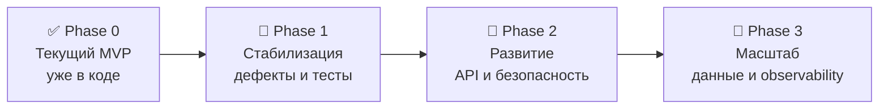
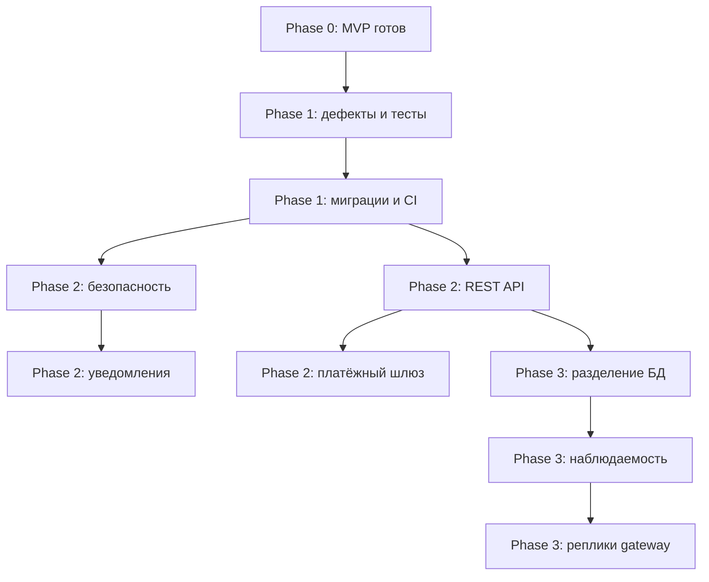

# 🗺️ Дорожная карта

## 📌 TL;DR

Текущий MVP сохраняет весь существующий функционал и микросервисную структуру без изменения UX и данных. Phase 2 фокусируется на стабилизации: исправление дефектов, миграции, безопасность и JSON REST API; оплата рассматривается отдельно. Phase 3 — разделение хранилищ, наблюдаемость и масштабирование. Даты ниже — планируемые вехи, а не жёсткий график; числовых SLA не задано.

---

## 🧭 Общая схема фаз



---

## 📅 Диаграмма Ганта

```mermaid
gantt
    title Дорожная карта проекта
    dateFormat YYYY-MM-DD
    axisFormat %b %Y

    section Phase 0 — MVP
    Микросервисный рефакторинг        :done, mvp0, 2026-10-01, 45d
    Сохранение 51 маршрута и данных   :done, mvp1, after mvp0, 10d

    section Phase 1 — Стабилизация
    Исправление BUG-001…BUG-004      :active, fix1, 2026-11-25, 20d
    Внедрение pytest и CI            :tests1, after fix1, 25d
    Миграции Alembic и триггеры      :mig1, after fix1, 30d

    section Phase 2 — Развитие
    Безопасность: CSRF, пароли, rate  :sec2, after mig1, 30d
    JSON REST API /api/v1            :api2, after tests1, 40d
    Уведомления email/SMS            :notify2, after sec2, 25d
    Платёжный шлюз (отдельно)        :pay2, after api2, 45d

    section Phase 3 — Масштаб
    Разделение БД по сервисам        :db3, after api2, 60d
    Наблюдаемость и логи             :obs3, after db3, 30d
    Несколько реплик gateway         :scale3, after obs3, 30d
```

---

## 📊 Приоритизация по MoSCoW

| Приоритет | Что включено | Фаза |
|-----------|--------------|------|
| **Must** | Сохранение текущего функционала, маршрутов и данных; исправление BUG-001…BUG-004; отключение debug в проде | Phase 0 → 1 |
| **Should** | Автотесты и CI; миграции Alembic; CSRF-защита; политика паролей; rate limiting | Phase 1 → 2 |
| **Could** | Публичный JSON REST API; email/SMS-уведомления; платёжный шлюз; локальные CDN-ресурсы | Phase 2 |
| **Won't (сейчас)** | Мультиязычность; мобильное приложение; формальное соответствие WCAG; числовые SLA | — |

---

## 🚀 Phase 0 — Текущий MVP (реализовано)

| Направление | Результат | Связь |
|-------------|-----------|-------|
| Архитектура | Gateway + 5 сервисов, `common/`, реестр сервисов | [Архитектура](./02-architecture.md) |
| Функционал | Каталог, поиск, брони, отзывы, панели менеджера и админа | [Требования](./01-business-requirements.md) |
| Данные | 7 таблиц, общая PostgreSQL, сиды, триггеры в файле | [Модель данных](./05-data-model.md) |
| Интерфейс | Только русский язык, Bootstrap/Font Awesome | [Сценарии](./04-user-flows.md) |
| Проверки | compile, smoke, role-тест, 51 маршрут | [Тестирование](./06-testing-strategy.md) |

**Принцип Phase 0:** не менять визуал, функции, данные и маршруты.

---

## 🔧 Phase 1 — Стабилизация

| ID | Задача | Приоритет | Риск, который закрывает |
|----|--------|-----------|-------------------------|
| P1-01 | Добавить `profile.html` / убрать маршрут `/profile` | Must | RISK-008 |
| P1-02 | Исправить `seed_big_data.py` | Must | RISK-009 |
| P1-03 | Заменить `to_char` на кросс-СУБД форматирование | Should | BUG-003 |
| P1-04 | Атомарная регистрация `User` + `Customer` | Must | RISK-011 |
| P1-05 | Внедрить Alembic и применить `triggers.sql` | Should | RISK-002, RISK-003 |
| P1-06 | `pytest` + CI с unit/integration/route-тестами | Should | RISK-012 |
| P1-07 | Отключить `debug=True` в продакшене, WSGI-сервер | Must | RISK-004 |
| P1-08 | Зафиксировать зависимости lock-файлом и `pip-audit` | Should | RISK-010, RISK-022 |
| P1-09 | Убрать хардкод БД из `test_connection.py` | Must | RISK-007 |

---

## 🚀 Phase 2 — Развитие

| ID | Задача | Приоритет | Комментарий |
|----|--------|-----------|-------------|
| P2-01 | CSRF-токены (Flask-WTF) | Should | RISK-006 |
| P2-02 | Политика паролей от 12 символов | Should | RISK-005 |
| P2-03 | Rate limiting и блокировка аккаунта | Should | RISK-014 |
| P2-04 | Менеджер секретов и ротация `SECRET_KEY` | Should | RISK-016 |
| P2-05 | Публичный JSON REST API `/api/v1` | Could | Описан в [архитектуре](./02-architecture.md) |
| P2-06 | Единый формат ошибки и версионирование | Could | Вместе с P2-05 |
| P2-07 | Email/SMS-уведомления о статусе брони | Could | RISK-018 |
| P2-08 | Платёжный шлюз: hosted checkout + webhook | Could | Отдельный проект, PCI DSS — [риски](./03-risks.md) |
| P2-09 | Политика персональных данных РБ и согласие | Should | RISK-020 |
| P2-10 | Локальные копии CDN-ресурсов / SRI | Could | RISK-013 |

> 💳 Оплата в текущем MVP намеренно пропущена: реального шлюза и данных карт в системе нет. P2-08 — отдельная инициатива, не блокирующая остальные задачи.

---

## 🧩 Phase 3 — Масштабирование

| ID | Задача | Приоритет | Комментарий |
|----|--------|-----------|-------------|
| P3-01 | Разделение общей БД на схемы/хранилища по сервисам | Could | RISK-001 |
| P3-02 | Событийная интеграция вместо прямых запросов | Could | Снижение связности |
| P3-03 | Structured logs, метрики, алерты | Could | RISK-009 (OWASP A09) |
| P3-04 | Circuit breaker и ретраи в gateway | Should | RISK-015 |
| P3-05 | Несколько реплик gateway + балансировщик | Could | RISK-015 |
| P3-06 | Автомасштабирование сервисов по нагрузке | Won't | Долгосрочно |

---

## 🔗 Зависимости между фазами



---

## ✅ Критерии завершения фаз

| Фаза | Критерий |
|------|----------|
| Phase 1 | BUG-001…BUG-004 закрыты, CI зелёный, debug выключен |
| Phase 2 | API `/api/v1` задокументирован, CSRF и политика паролей включены, уведомления работают |
| Phase 3 | Сервисы имеют независимые хранилища, логи и метрики централизованы, gateway масштабируется |

---

## 🔗 Ссылки

- [Бизнес-требования](./01-business-requirements.md)
- [Архитектура](./02-architecture.md)
- [Риски](./03-risks.md)
- [Пользовательские сценарии](./04-user-flows.md)
- [Модель данных](./05-data-model.md)
- [Стратегия тестирования](./06-testing-strategy.md)
