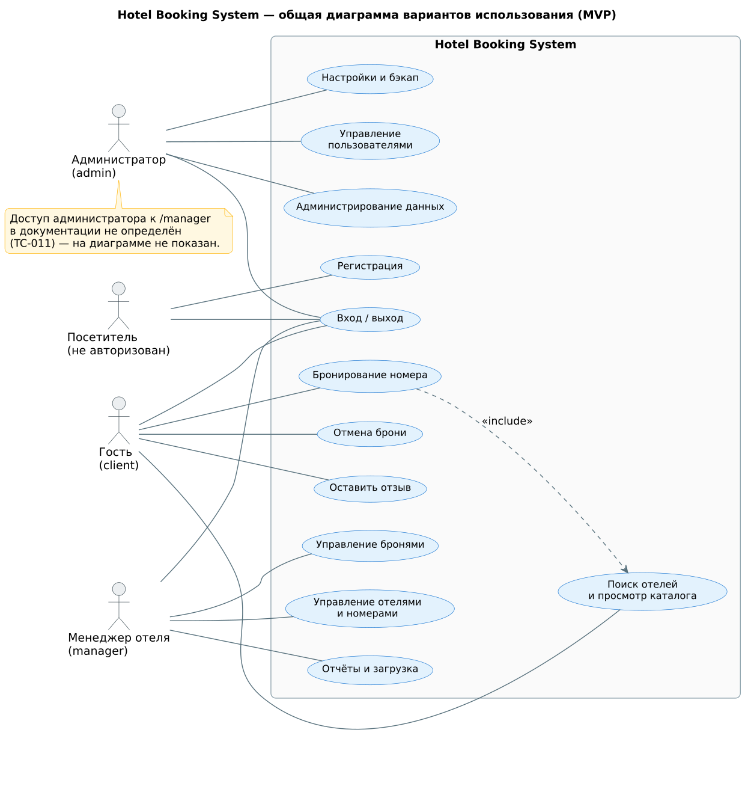
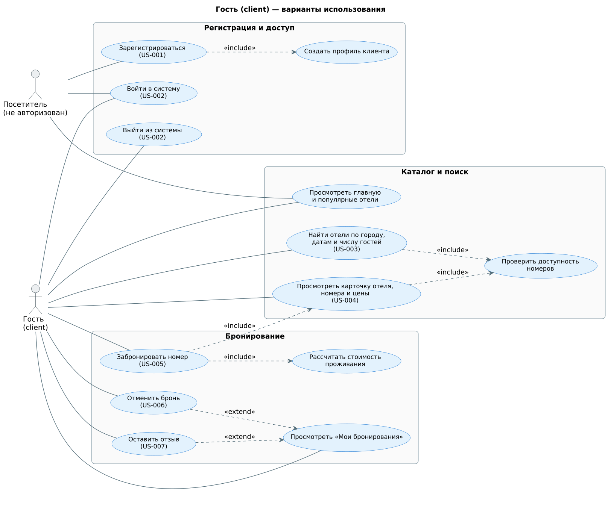
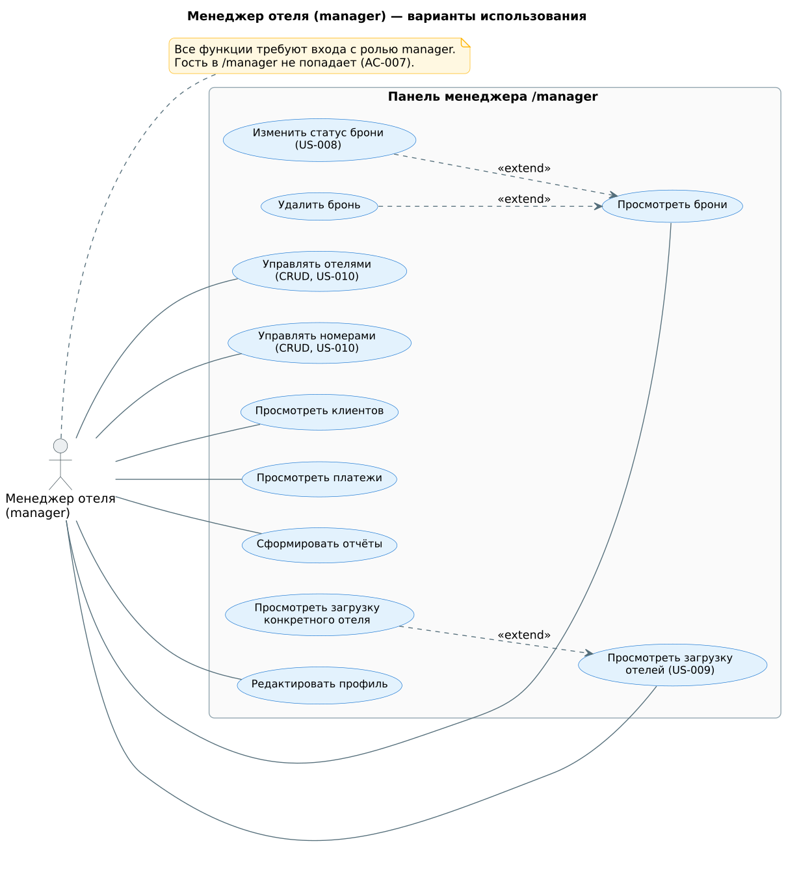
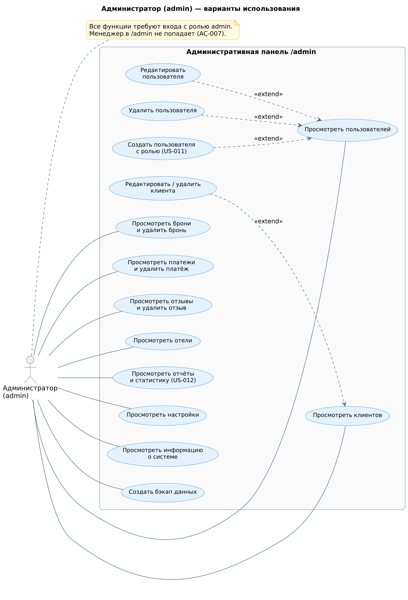
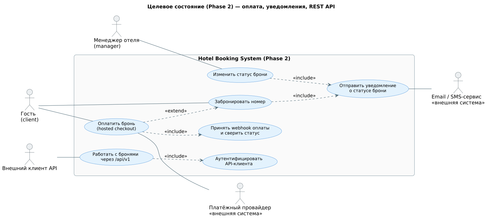

# 🎭 Диаграммы вариантов использования (UML Use Case)

## 📌 TL;DR

Пять UML-диаграмм вариантов использования: общая картина MVP, отдельные диаграммы для гостя, менеджера и администратора, а также целевое состояние Phase 2 (оплата, уведомления, REST API). Каждый вариант использования привязан к user stories (`US-*`), требованиям (`FR-*`) и критериям приёмки (`AC-*`) из [бизнес-требований](./01-business-requirements.md). Исходники диаграмм — PlantUML в [`diagrams/src`](./diagrams/src), готовые картинки — в [`diagrams/img`](./diagrams/img).

---

## 👥 Актёры

| Актёр | Роль в системе | Тип | Основание |
|-------|----------------|-----|-----------|
| Посетитель (не авторизован) | — | Первичный | Регистрация и вход, главная страница |
| Гость | `client` | Первичный | US-001…US-007 |
| Менеджер отеля | `manager` | Первичный | US-008…US-010 |
| Администратор | `admin` | Первичный | US-011, US-012 |
| Платёжный провайдер | — | Внешняя система (Phase 2) | FR-024, P2-08 |
| Email / SMS-сервис | — | Внешняя система (Phase 2) | FR-025, P2-07 |
| Внешний клиент API | — | Внешняя система (Phase 2) | FR-023, P2-05 |

---

## 1️⃣ Общая диаграмма (MVP)

Обзор всех ролей и укрупнённых групп функций. Детали — на диаграммах ниже.



Исходник: [`01-system-overview.puml`](./diagrams/src/01-system-overview.puml)

---

## 2️⃣ Гость (`client`)



Исходник: [`02-guest.puml`](./diagrams/src/02-guest.puml)

| Вариант использования | User story | Требование | Критерий приёмки | Результат |
|-----------------------|------------|------------|------------------|-----------|
| Зарегистрироваться | US-001 | FR-001, FR-020 | AC-001 | Созданы `User` и связанный `Customer`, редирект на `/auth/login` |
| Войти / выйти | US-002 | FR-002, FR-003 | AC-002 | Переход на страницу по роли (`/search`, `/manager`, `/admin`) |
| Найти отели по городу, датам и числу гостей | US-003 | FR-006, FR-007 | AC-003 | В результатах только отели со свободными номерами |
| Просмотреть карточку отеля, номера и цены | US-004 | FR-005 | — | Отображаются номера и цены |
| Забронировать номер | US-005 | FR-008 | AC-004 | `Booking` со статусом `pending` и рассчитанной `total_price` |
| Просмотреть «Мои бронирования» | — | FR-009 | — | Список броней текущего клиента |
| Отменить бронь | US-006 | FR-010 | AC-005 | Статус `cancelled`, заполнен `cancelled_at` |
| Оставить отзыв | US-007 | FR-011 | AC-006 | Отзыв сохранён и виден на странице отеля; только для существующей брони |

---

## 3️⃣ Менеджер отеля (`manager`)



Исходник: [`03-manager.puml`](./diagrams/src/03-manager.puml)

| Вариант использования | User story | Требование | Критерий приёмки |
|-----------------------|------------|------------|------------------|
| Просмотреть брони | — | FR-012 | — |
| Изменить статус брони | US-008 | FR-012 | AC-008 |
| Удалить бронь | — | FR-012 | — |
| Управлять отелями (CRUD) | US-010 | FR-013 | — |
| Управлять номерами (CRUD) | US-010 | FR-013 | — |
| Просмотреть клиентов и платежи | — | FR-014 | — |
| Сформировать отчёты | — | FR-014 | — |
| Просмотреть загрузку отелей | US-009 | FR-015 | — |
| Редактировать профиль | — | — | — |

Ограничение доступа: гость в `/manager` не попадает (AC-007).

---

## 4️⃣ Администратор (`admin`)



Исходник: [`04-admin.puml`](./diagrams/src/04-admin.puml)

| Вариант использования | User story | Требование | Критерий приёмки |
|-----------------------|------------|------------|------------------|
| Просмотреть, создать, редактировать, удалить пользователя | US-011 | FR-016 | AC-009 |
| Просмотреть, редактировать, удалить клиента | — | FR-017 | — |
| Просмотреть брони, платежи, отзывы и удалить записи | — | FR-017 | — |
| Просмотреть отели | — | FR-017 | — |
| Просмотреть отчёты и статистику | US-012 | FR-017 | — |
| Просмотреть настройки и информацию о системе | — | FR-018 | — |
| Создать бэкап данных | — | FR-019 | — |

Ограничения доступа: гость и менеджер в `/admin` не попадают (AC-007). Бэкап использует внешние команды — см. [RISK-017](./03-risks.md).

---

## 5️⃣ Целевое состояние (Phase 2)

Диаграмма показывает то, чего в MVP нет: оплата через внешнего провайдера, уведомления и публичный REST API. Все пункты — приоритета Could/Won't.



Исходник: [`05-phase2.puml`](./diagrams/src/05-phase2.puml)

| Вариант использования | Требование | Задача roadmap | Связанные риски |
|-----------------------|------------|----------------|-----------------|
| Оплатить бронь (hosted checkout) | FR-024 | P2-08 | RISK-019, PCI-001…PCI-005 |
| Принять webhook оплаты и сверить статус | FR-024 | P2-08 | PCI-003, PCI-004 |
| Отправить уведомление о статусе брони | FR-025 | P2-07 | RISK-018 |
| Работать с бронями через `/api/v1` | FR-023 | P2-05, P2-06 | — |

---

## 🧾 Обозначения на диаграммах

| Элемент | Значение |
|---------|----------|
| Человечек | Актёр (роль или внешняя система) |
| Эллипс | Вариант использования |
| Сплошная линия | Ассоциация актёра с вариантом использования |
| `«include»` | Базовый сценарий всегда включает вложенный |
| `«extend»` | Сценарий-расширение выполняется при определённом условии; стрелка идёт от расширения к базовому сценарию |
| Прямоугольник | Граница системы |

---

## ❓ Допущения и открытые вопросы

| № | Вопрос | Как отражено на диаграмме |
|---|--------|---------------------------|
| 1 | Доступ администратора к `/manager` не определён (TC-011: «в соответствии с матрицей прав») | На диаграмме не показан |
| 2 | Требуется ли вход для просмотра каталога и поиска — в документации прямо не сказано; известно только, что `/search` может отвечать редиректом `302` | Для неавторизованного посетителя показаны только регистрация, вход и главная страница; поиск и каталог — у гостя |
| 3 | Маршрут `/profile` возвращает ошибку из-за отсутствующего шаблона (RISK-008) | Вариант использования «Редактировать профиль гостя» не показан |

---

## 🛠️ Как перерисовать диаграммы

Диаграммы описаны в PlantUML. После правки `.puml`-файлов запустите:

```bash
./scripts/render-diagrams.sh
```

Скрипт требует Java и Graphviz (`dot`), а также `plantuml.jar` (путь можно передать переменной `PLANTUML_JAR`). Он перегенерирует SVG и PNG в `docs/diagrams/img`.

---

## 🔗 Ссылки

- [Бизнес-требования](./01-business-requirements.md) — user stories, FR/NFR, критерии приёмки
- [Пользовательские сценарии](./04-user-flows.md) — пошаговые flow и wireframe
- [Риски](./03-risks.md) — реестр рисков, PCI DSS
- [Дорожная карта](./07-roadmap.md) — задачи Phase 2
