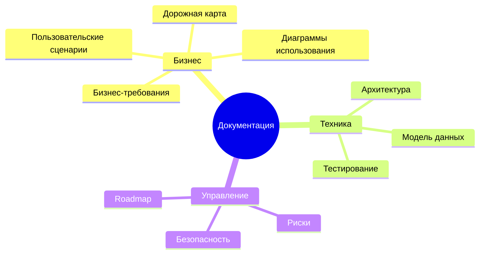

# 📚 Документация проекта «Hotel Booking System»

## 📌 TL;DR

Это полный пакет документации по проекту бронирования отелей: бизнес-требования, архитектура, риски, пользовательские сценарии, модель данных, стратегия тестирования и дорожная карта. Проект — Python/Flask-приложение, разделённое на микросервисы с API Gateway; интерфейс на русском языке, данные хранятся в PostgreSQL. Документация описывает **текущее состояние** (MVP) и целевые улучшения.

---

## 🧭 Навигация по документации

---

## 📂 Оглавление

| № | Файл | Описание |
|---|------|----------|
| 01 | [Бизнес-требования](./01-business-requirements.md) | Цели, персоны, User Stories, FR/NFR, MoSCoW, критерии приёмки, Scope MVP |
| 02 | [Архитектура](./02-architecture.md) | Слои, стек, компонентная схема, sequence-диаграммы, ER, описание API |
| 03 | [Риски](./03-risks.md) | Реестр рисков, матрица, OWASP, PCI DSS, персональные данные, интеграции |
| 04 | [Пользовательские сценарии](./04-user-flows.md) | Mermaid-flow сценариев и текстовые wireframe ключевых экранов |
| 05 | [Модель данных](./05-data-model.md) | ER-диаграмма, поля, типы, ограничения, индексы, связи |
| 06 | [Стратегия тестирования](./06-testing-strategy.md) | Пирамида тестов, матрица тест-кейсов, негативные сценарии |
| 07 | [Дорожная карта](./07-roadmap.md) | MVP → Phase 2 → Phase 3, Mermaid Gantt, приоритизация MoSCoW |
| 08 | [Диаграммы вариантов использования](./08-use-cases.md) | UML Use Case: общая схема, гость, менеджер, администратор, Phase 2 |
| — | [Архитектура кода](../ARCHITECTURE.md) | Описание микросервисной структуры прямо в коде проекта |

---

## 🏨 Краткое резюме проекта

**Назначение.** Веб-система для поиска отелей, просмотра номеров, бронирования, управления бронями и отзывами. Имеются роли: гость (`client`), менеджер отеля (`manager`), администратор (`admin`).

**Что реализовано на момент анализа:**

- регистрация и вход/выход с хешированием пароля (Flask-Login);
- каталог отелей и номеров, поиск по городу и датам, проверка доступности номеров;
- создание и отмена брони, «мои бронирования»;
- отзывы с привязкой к бронированию;
- менеджерская панель: брони, отели, номера, клиенты, платежи, отчёты, загрузка;
- административная панель: пользователи, клиенты, брони, платежи, отзывы, настройки, бэкап;
- микросервисное разделение: API Gateway + 5 независимых сервисов;
- общая PostgreSQL-база, сиды тестовых данных, SQL-триггеры в файле `triggers.sql`.

**Важные ограничения текущего состояния:**

- интерфейс только на русском языке;
- реального платёжного шлюза нет (оплата обсуждается отдельно и в MVP не интегрирована);
- формального требования WCAG не зафиксировано;
- числовых SLA-целей не задано — цели описаны качественно;
- автоматизированных тестов в репозитории нет.

---

## 🧩 Как читать документацию

1. Начните с [бизнес-требований](./01-business-requirements.md), чтобы понять цели и границы MVP.
2. Затем изучите [архитектуру](./02-architecture.md) и [модель данных](./05-data-model.md).
3. Для проектирования интерфейса используйте [сценарии](./04-user-flows.md).
4. Перед релизом проверьте [риски](./03-risks.md) и [стратегию тестирования](./06-testing-strategy.md).
5. Планирование развития — в [дорожной карте](./07-roadmap.md).
6. Роли и сценарии использования в виде UML — в [диаграммах вариантов использования](./08-use-cases.md).

---

## 🔗 Связь с кодом

- Точка входа: `app.py` (API Gateway, порт 5000).
- Реестр сервисов: `services/registry.py`.
- Общее ядро: `common/`.
- Модели БД: `common/models.py`.
- Карта маршрутов: `common/urls.py`.
- Описание структуры сервисов: [ARCHITECTURE.md](../ARCHITECTURE.md).
